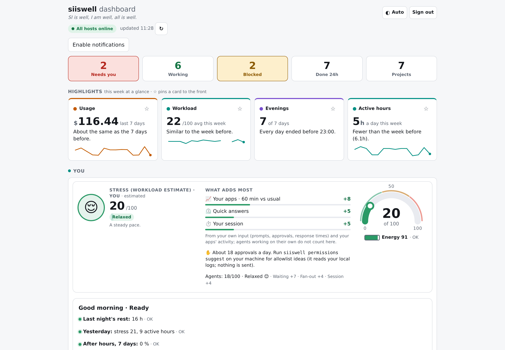
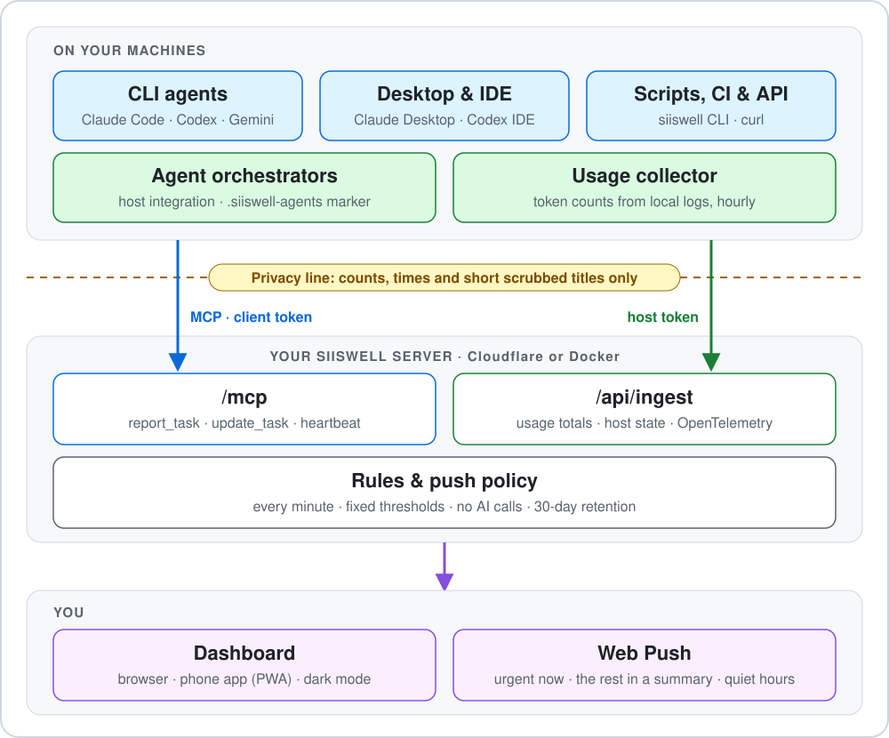
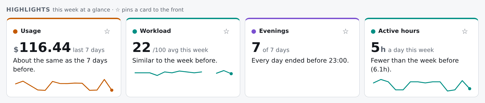
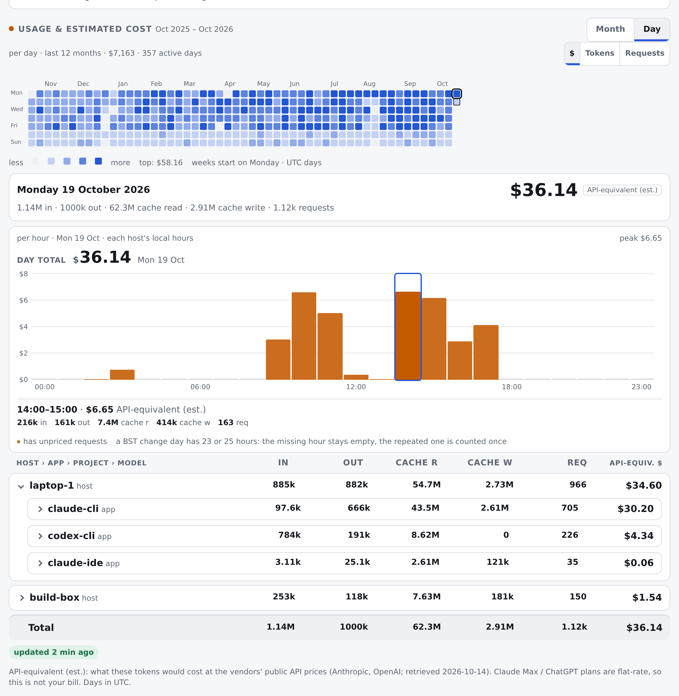
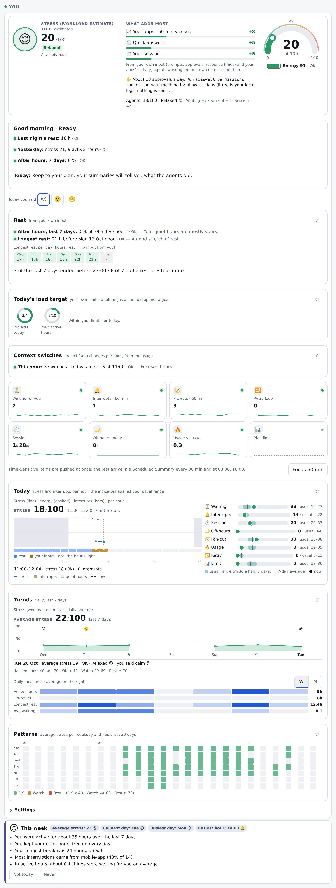
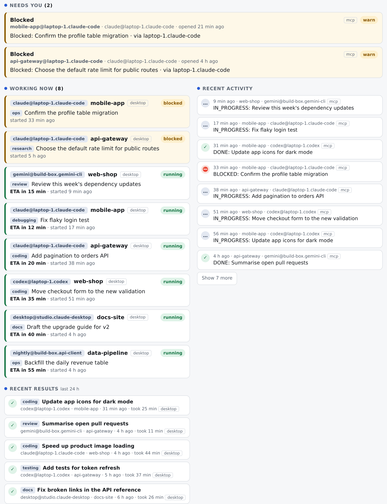
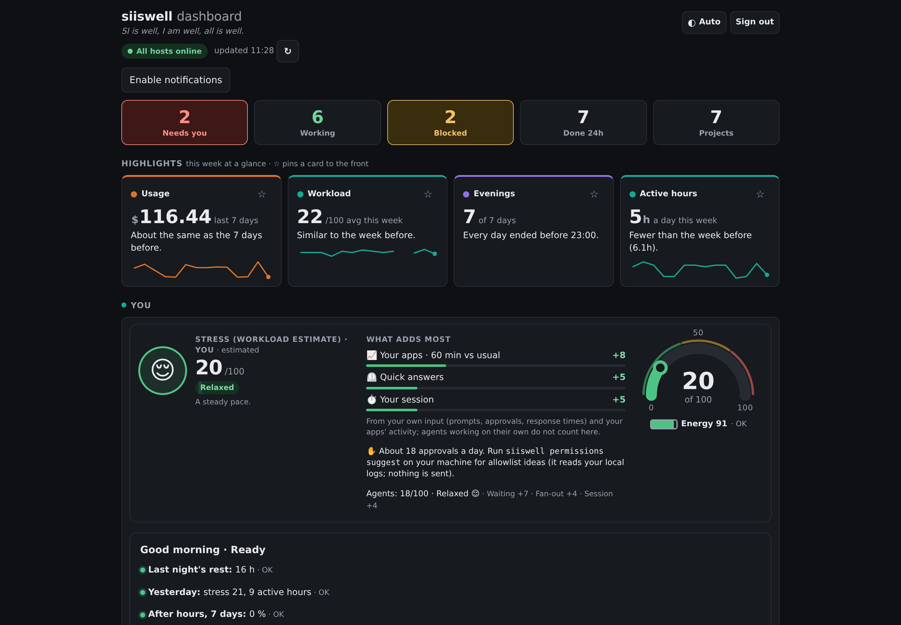
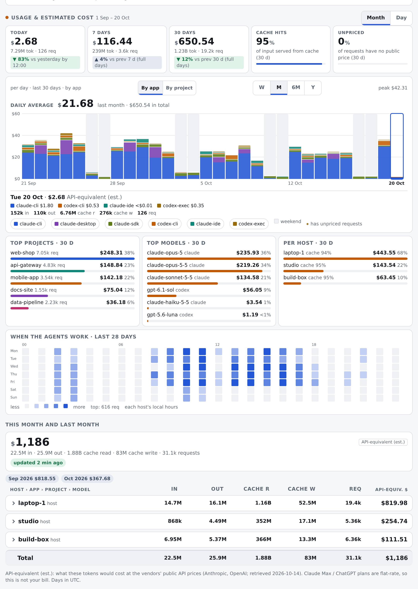
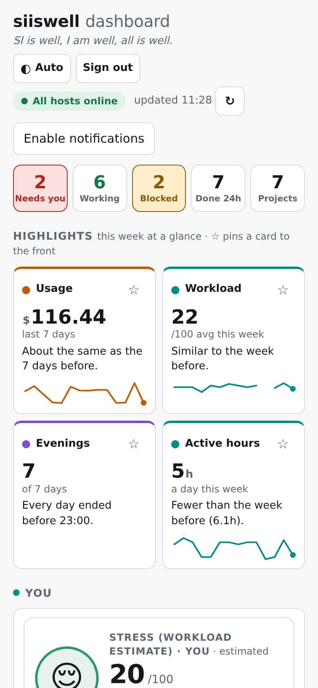

<div align="center">

[English](README.md) · [日本語](README.ja.md) · [Deutsch](README.de.md) · [Español](README.es.md) · **Português (Brasil)** · [Français](README.fr.md) · [한국어](README.ko.md) · [繁體中文](README.zh-Hant.md)

# siiswell

### SI is well, I am well.

<sub>(A SI está bem, eu estou bem.)</sub>

**Uma página tranquila para ver o que seus agentes de IA estão fazendo, quanto isso custa e como você está.**

<sub><b>SI</b> = superinteligência: os agentes de IA que trabalham para você. Quando eles estão bem e você está bem, tudo está bem.</sub>

Open source · self-hosted · funciona com qualquer cliente MCP · zero chamadas de IA · privacidade por padrão

[Por quê](#por-que-siiswell) · [Como funciona](#como-funciona) · [O que é diferente](#o-que-torna-o-siiswell-diferente) · [Recursos](#recursos) · [Clientes](#funciona-com-as-ferramentas-que-você-já-usa) · [Início rápido](#início-rápido) · [Prompts](#prompts-para-copiar-e-colar-nos-seus-agentes) · [Privacidade](#privacidade-o-que-sai-da-sua-máquina) · [FAQ](#perguntas-frequentes) · [Documentação](#documentação)



</div>

---

**siiswell** é um **dashboard para agentes de IA de programação** gratuito, open source e self-hosted, para ferramentas como Claude Code, Codex e Gemini
CLI. Ele mostra quais tarefas dos agentes estão em andamento ou esperando por você, acompanha o **uso de tokens de LLM e o custo equivalente em API**, envia
notificações tranquilas para o celular e cuida da pessoa no meio de tudo com sinais de **bem-estar do desenvolvedor** baseados em regras —
sem nunca chamar um modelo de IA nem ler seus prompts e seu código. Feito hoje para uma pessoa; recursos para equipes estão planejados.

## Por que siiswell

Agentes de programação com IA agora rodam sozinhos por minutos ou horas, muitas vezes vários ao mesmo tempo, em terminais,
apps de desktop, servidores e CI. Isso é ótimo para a produtividade e pesado para a pessoa no meio de tudo.

| A dor do dia a dia | O que o siiswell faz a respeito |
|---|---|
| **"Ainda está trabalhando ou está esperando por mim?"** Você confere cinco abas de terminal para achar o único agente que está pedindo permissão há 40 minutos. | Cada agente informa suas tarefas longas (iniciada, bloqueada, concluída, ETA). A lista **Precisa de você** e um push no seu celular avisam no momento em que algo está esperando. |
| **Agentes em vários lugares.** Claude Code no notebook, Codex em um servidor, um app de desktop, um script noturno. Nenhuma visão única. | Um dashboard para todas as máquinas, apps e projetos, agrupados como `machine / project`. |
| **"Quanto custou este mês?"** As contagens de tokens ficam enterradas em logs locais; os planos de assinatura escondem o preço equivalente na API. | O coletor de uso lê os **números** de tokens dos logs locais e mostra tokens e custo equivalente na API por dia, hora, host, app, projeto e modelo. |
| **Excesso de notificações.** Ou você perde o aviso importante, ou o celular vibra a noite inteira. | Os pushes são escalonados: itens urgentes na hora, o resto em um resumo; horário de silêncio, um botão de Foco e Foco baseado no calendário. |
| **Dias longos vão se acumulando.** Agentes nunca se cansam; pessoas, sim. | Um card **Você** gentil e baseado em regras: quão cheio o dia realmente foi, um lembrete para fazer uma pausa, uma mensagem de encerramento à noite. Sem pontuações, sem sequências. |
| **"Posso confiar meu código a mais um dashboard?"** | Ele nunca vê prompts, código ou conteúdo de arquivos. Nunca chama um modelo de IA. Você mesmo o hospeda. |

## Como funciona

<p align="center"></p>

1. **Os agentes informam.** Uma regra curta nas instruções de cada agente pede que ele chame `report_task` ao iniciar algo
   longo e `update_task` quando estiver bloqueado ou terminar. Os hooks do Claude Code e do Codex também podem informar
   "esperando por você" por conta própria.
2. **Coletam-se números, não conteúdo.** O coletor de uso transforma logs locais em totais de tokens por hora e por modelo.
   Os hooks guardam apenas *que* você interagiu e quando.
3. **O servidor decide, de forma determinística.** Regras fixas (bloqueado, atrasado, um pedido de permissão esperando, host
   offline, limite do plano perto) abrem alertas; a política de push decide o que chega ao seu celular agora, mais tarde ou nunca.
4. **Você olha uma vez.** Uma página, na sua mesa ou no seu celular, com a resposta no topo.

## O que torna o siiswell diferente

| | |
|---|---|
| 🧘 **Ele cuida da pessoa, não só dos agentes** | A maioria das ferramentas de agentes conta tokens. O siiswell também percebe o humano: há quanto tempo você está nisso, com que rapidez está respondendo, se a noite ainda é sua. Ele sugere com gentileza e nunca dá nota para você. |
| 🔕 **Menos notificações, na hora certa** | Itens urgentes chegam ao seu celular na hora; todo o resto espera por um resumo. Horário de silêncio, Foco e seu calendário decidem o restante, e os agentes ficam sabendo quando você está ausente, para que sigam em frente em vez de esperar. |
| 🔒 **Uma linha de privacidade que você consegue ler** | Só contagens, horários e títulos curtos e limpos saem da sua máquina. O texto é limpo duas vezes (cliente e servidor) e o servidor impõe seu próprio limite. Prompts, código e conteúdo de arquivos nunca atravessam. |
| 🧮 **Zero IA, totalmente explicável** | Nenhum modelo é chamado, então não custa nada para rodar e cada alerta vem de um limite que você pode ler no código. |
| 🔌 **Qualquer agente, em qualquer lugar** | Uma pequena regra nas instruções do agente basta. MCP, uma CLI, HTTP simples ou OpenTelemetry: terminais, apps de desktop, servidores, CI e orquestradores de agentes chegam todos a uma única página. |
| 🏠 **Hospedado por você** | Um Cloudflare Worker ou um contêiner Docker, single-tenant por design. Seus dados ficam na sua conta. |

## Recursos

<table>
<tr><td width="50%" valign="top">

### Tarefas dos agentes
- Caixa de entrada **Precisa de você**: tarefas bloqueadas e pedidos de permissão esperando por você, das mais antigas para as mais novas
- **Em andamento**: cada tarefa aberta com ETA, indicador de atraso e horário de início
- **Resultados recentes** das últimas 24 horas
- Agrupado por máquina, app e projeto; tarefas paradas se fecham sozinhas após 24 h
- Cinco ferramentas MCP, incluindo `list_tasks` e `operator_status`, somente leitura

</td><td width="50%" valign="top">

### Uso e custo
- Heatmap de calendário de 12 meses e as 24 horas de qualquer dia
- Tokens e **custo equivalente na API** por host, app, projeto e modelo
- Logs do Claude Code e do Codex, além de ingestão via OpenTelemetry
- Previsão do limite do plano: "Neste ritmo, a janela de 5 h se esgota por volta das 16:40"
- Tabela de preços por modelo, com seus próprios ajustes

</td></tr>
<tr><td valign="top">

### Notificações tranquilas
- Web Push para celular e desktop (PWA instalável)
- Itens **Time-Sensitive** na hora, todo o resto em um **Scheduled Summary**
- Horário de silêncio, fins de semana, **Foco 60 min**, Foco a partir do seu calendário
- Alertas relacionados agrupados em um único push; lembretes escalonados em vez de repetições
- Modo caixa de entrada opcional: pedidos de permissão pendentes chegam juntos a cada 15 ou 30 minutos

</td><td valign="top">

### Você, a pessoa
- **Tranquilo / Ocupado / Sobrecarregado**, sempre com os motivos
- Um nível estimado de carga de trabalho (0–100) a partir de oito sinais transparentes
- **Destaques**: a semana em frases simples, com sua faixa habitual mostrada em cada indicador
- Linha do tempo de hoje, tendências de 7 e 30 dias, reflexão semanal; fixe os cards que importam para você
- Sugestões gentis (pausa, ritmo, horário de silêncio), cada uma com "Hoje não" e "Nunca"
- Mensagens de encerramento e de bom-dia; os agentes ficam sabendo quando você está ausente

</td></tr>
<tr><td valign="top">

### Privacidade e segurança
- Nunca prompts, código, argumentos de ferramentas ou conteúdo de arquivos
- Nomes de projetos com hash por padrão; texto limpo no cliente **e** no servidor
- Um token por máquina e app, revogável individualmente
- Limites no servidor para quanto texto de tarefa é aceito

</td><td valign="top">

### Roda onde você quiser
- **Cloudflare** Worker + D1, ou **Docker** com SQLite
- Cloudflare Access, login embutido ou seu próprio proxy de autenticação
- CLI sem dependências (Node ≥ 18) que se atualiza sozinha
- AGPL-3.0, licença comercial sob consulta

</td></tr>
</table>

## Capturas de tela

<p align="center"><br/><b>Destaques</b> — a semana em quatro frases simples; fixe as que importam para você</p>

| | |
|---|---|
| <br/>**Uso e custo** — um ano de relance, depois o detalhe de um dia | <br/>**Você** — como o dia está indo, com os motivos |
| <br/>**Tarefas** — o que espera por você, o que está rodando | <br/>**Tema escuro** — segue o seu dispositivo, ou escolha um |
| <br/>**Visão mensal** — totais, principais projetos e modelos, dia da semana × hora | <br/>**No celular** — instale como app e receba pushes |

<sub>As capturas de tela usam dados de demonstração de <code>scripts/demo-seed.ts</code>.</sub>

## Funciona com as ferramentas que você já usa

Qualquer coisa que fale MCP pode informar tarefas. Qualquer coisa que consiga rodar um comando ou enviar HTTP também.

| Tipo de cliente | Exemplos | Como se conecta | O que aparece no dashboard |
|---|---|---|---|
| **Agentes de CLI** | Claude Code, Codex, Gemini CLI, Antigravity (agy), opencode, grok, kilo | `siiswell mcp` (stdio) registrado pelo script de setup, ou MCP remoto com um header bearer | Tarefas; com os hooks do Claude Code / Codex, também "esperando por você" e o seu próprio ritmo |
| **Apps de desktop e IDEs** | Claude Desktop, app de desktop do ChatGPT, extensão Codex para IDE | servidor MCP stdio (`siiswell mcp`) | Tarefas |
| **Qualquer cliente MCP remoto** | qualquer coisa com Streamable HTTP + headers personalizados | `POST /mcp` com `Authorization: Bearer <token>` | Tarefas |
| **Agentes na nuvem** | Manus, Grok (MCP remoto via API), OpenAI Dots, conectores personalizados do ChatGPT | adicione `https://<your-dashboard>/mcp` como servidor MCP personalizado com um header de bearer token / API key ([detalhes](#agentes-na-nuvem-manus-grok-dots-chatgpt)) | Tarefas |
| **Scripts, cron e CI** | jobs de build, migrações longas, tarefas noturnas | `siiswell report` / `update` / `heartbeat` | Tarefas e heartbeats |
| **HTTP / API direto** | qualquer linguagem | JSON-RPC para `/mcp`; endpoints de ingestão no [OpenAPI](docs/openapi.yaml) (em inglês) | Tarefas, uso, estado do host |
| **Orquestradores de agentes** | seu próprio executor de agentes, servidores de automação | endpoints de integração de host `/api/ingest/{snapshot,events,heartbeat}`; um marcador `.siiswell-agents` mantém os hooks fora dos workspaces dele | Hosts, projetos, agentes, tarefas, eventos |
| **Uso de tokens** | logs do Claude Code e do Codex | `siiswell usage push` em um agendamento | Tokens e custo equivalente na API |
| **OpenTelemetry** | métricas do Claude Code | OTLP/HTTP JSON para `/api/ingest/otlp` (opcional) | Tokens e custo |

Snippets e status por app: [CLIENTS.md](CLIENTS.md). Instalação passo a passo: [docs/INSTALL-CLIENTS.md](docs/INSTALL-CLIENTS.md).

## Início rápido

### Termos que você vai ver

| Termo | Significado |
|---|---|
| **Servidor** | o próprio dashboard: um contêiner Docker (ou um Cloudflare Worker) que guarda os relatórios e mostra a página |
| **Cliente** | o pequeno programa `siiswell` em cada computador onde seus agentes rodam |
| **MCP** | a forma padrão de agentes de IA chamarem ferramentas; o siiswell dá aos agentes uma ferramenta de "informar minha tarefa" |
| **Token de cliente** | uma chave que permite a um app de agente (o Claude Code no seu notebook, por exemplo) informar tarefas |
| **Token de host** | uma chave que permite ao coletor de uso de um computador enviar contagens de tokens; o nome dele deve ser igual ao rótulo desse computador |
| **Hooks** | pequenos comandos que o Claude Code / Codex executam em eventos (um prompt, um pedido de permissão), usados para "esperando por você" |

### Qual caminho é para mim?

| | **Docker** (recomendado para a maioria das pessoas) | **Cloudflare** (para quem já usa Workers) |
|---|---|---|
| Roda em | qualquer máquina com Docker: um servidor em casa, uma VPS, um NAS | sua conta Cloudflare (o plano gratuito geralmente é suficiente) |
| Login | embutido: uma senha de admin no `.env` | Cloudflare Access (seu login Google / GitHub / e-mail) |
| Pushes no celular | sim, assim que ele tiver um endereço HTTPS | sim |
| Tempo até a primeira tarefa | cerca de 10 minutos em uma máquina; cerca de 30 com HTTPS | cerca de 30 minutos |

### Docker, passo a passo

Você precisa de: uma máquina com Docker e Docker Compose para o servidor; Node.js 18+ e [Bun](https://bun.sh) em cada computador
cujos agentes você quer conectar. Para usar a partir de outros computadores ou do celular, você também precisa de um endereço HTTPS (passo 3).

**1. Baixe e defina uma senha** (na máquina do servidor)

```sh
git clone https://github.com/jcaol/siiswell.git siiswell && cd siiswell
cp .env.example .env && chmod 600 .env
```

Para uma primeira tentativa, só duas linhas do `.env` importam:

```dotenv
# the address you open; your https://… address after step 3
PUBLIC_URL=http://localhost:8787
# 12+ characters; to change it: edit, then docker compose up -d
ADMIN_PASSWORD='a long password you keep'
```

**2. Inicie e confira**

```sh
docker compose up -d --build
docker compose ps
curl -s http://localhost:8787/api/health
```

Depois de alguns segundos, o `docker compose ps` mostra **healthy** e a verificação de saúde responde `{"ok":true,…}`. Abra
<http://localhost:8787> e entre. Se não iniciar, `docker compose logs siiswell` lista cada configuração
que precisa ser corrigida. Em um servidor remoto sem navegador, abra antes um túnel a partir do seu notebook:
`ssh -L 8787:127.0.0.1:8787 you@your-server`, depois abra <http://localhost:8787> no notebook.

**3. Dê a ele um endereço HTTPS** (necessário para outros computadores e para o celular)

O contêiner escuta apenas em `127.0.0.1:8787`. Coloque na frente dele um proxy reverso com HTTPS, por exemplo o
[Caddy](https://caddyserver.com/), que obtém o certificado sozinho:

```text
# /etc/caddy/Caddyfile  (point the DNS name at this machine first)
dash.example.com {
    reverse_proxy 127.0.0.1:8787
}
```

Depois, no `.env`:

```dotenv
PUBLIC_URL=https://dash.example.com
# the proxy reaches the container from this address
TRUSTED_PROXY_CIDRS=172.28.0.1/32
```

e `docker compose up -d`. Não tem domínio? Um nome HTTPS privado de uma VPN como o Tailscale também funciona. Mais opções:
[docs/deploy.md](docs/deploy.md#deploy-with-docker).

**4. Pushes no celular** (opcional)

```sh
docker compose exec siiswell bun scripts/vapid.ts mailto:you@example.com
```

Cole no `.env` as três linhas `VAPID_…=` que ele imprime e rode `docker compose up -d`. No iPhone, abra o dashboard no
Safari, escolha Compartilhar → **Adicionar à Tela de Início**, abra a partir dali e toque em **Enable notifications**.

**5. Crie os tokens** (no servidor; cada token é exibido uma única vez, então mantenha a janela aberta para o passo 6)

```sh
docker compose exec siiswell bun scripts/new-token.ts laptop-1-claude client --apply
docker compose exec siiswell bun scripts/new-token.ts laptop-1-codex client --apply
docker compose exec siiswell bun scripts/new-token.ts laptop-1 host --apply
```

Um token de cliente por app de agente que você usa (aqui Claude Code e Codex), um token de host por computador. O nome do token de host
(`laptop-1`) é o rótulo da máquina que você vai digitar no passo 6.

**6. Conecte um computador** (em cada notebook ou desktop)

```sh
git clone https://github.com/jcaol/siiswell.git siiswell && cd siiswell
bun install && bun run build:cli
scripts/setup-client.sh
```

Ele pede a URL do dashboard (`https://dash.example.com`), um rótulo para a máquina (`laptop-1`), quais apps conectar e
um token por app (a entrada fica oculta). Ele instala o comando `siiswell` em `~/.local/bin`, adiciona a regra de relatório aos
seus agentes e pode adicionar os hooks e o coletor de uso de hora em hora. No final você deve ver `doctor claude-code: ok`.

Experimente (abra um novo terminal antes, se o `siiswell` não for encontrado). A tarefa aparece em **Em andamento**, o `siiswell tasks`
a lista e a última linha a encerra:

```sh
ID=$(siiswell report "Try the dashboard" --kind testing --eta-min 5 | tail -1)
siiswell tasks
siiswell update "$ID" --status DONE
```

Ou peça a um agente que rode a verificação de conexão ([prompt 3](#prompts-para-copiar-e-colar-nos-seus-agentes)).

### Mantendo em funcionamento

| Tarefa | Comando |
|---|---|
| Atualizar o servidor | `git pull && docker compose up -d --build` (as mudanças no banco de dados são aplicadas sozinhas) |
| Atualizar o cliente de um computador | `siiswell update` (sem um task id, instala a versão que o seu dashboard publica) |
| Parar / iniciar | `docker compose down` / `docker compose up -d` (seus dados permanecem) |
| Backup | `docker compose stop`, copie `/data/siiswell.sqlite` para fora do volume `siiswell-data` (`docker volume ls` mostra o nome completo), `docker compose start`. Guarde os backups com o mesmo cuidado que o `.env`: eles contêm o hash da senha |

⚠️ `docker compose down -v` apaga o volume, ou seja, todos os seus dados.

<details>
<summary><b>Cloudflare (Worker + D1)</b></summary>

```sh
bun install
bunx wrangler d1 create siiswell
```

Coloque o `database_id` exibido no `wrangler.toml` e depois:

```sh
bunx wrangler d1 migrations apply siiswell --remote
bun run deploy
bun scripts/new-token.ts laptop-1-claude client
```

O último comando exibe um token e uma linha `wrangler d1 execute`: rode essa linha para registrar o token.

Proteja a página com o Cloudflare Access: até que ele esteja configurado, o dashboard não mostra dados a ninguém. O checklist
completo, com cada passo voltado para fora marcado, está em [docs/deploy.md](docs/deploy.md). Depois conecte seus computadores como no passo 6.
</details>

## Prompts para copiar e colar nos seus agentes

Os agentes fazem os relatórios, então precisam ser instruídos. É seguro colar estes prompts em qualquer agente: nenhum deles
pede ou contém um token. **Nunca cole um token em um chat**: tokens vão no arquivo de configuração ou nas configurações do conector.

Os agentes entendem os prompts em inglês abaixo; se preferir, você também pode escrevê-los em português.

<details open>
<summary><b>1. A regra de relatório</b> (coloque nas instruções globais de cada agente; o <code>setup-client.sh</code> faz isso por você)</summary>

```text
For any task that will take longer than about 10 minutes, you may use the `siiswell` MCP tools: call
`report_task` (status `IN_PROGRESS`, with `eta_min`) when you start; call `update_task` with status
`BLOCKED` when you are blocked and need me, and with `DONE` when you finish, reusing the `task_id` you
were given. Always call `update_task` with `DONE` before your final reply. Give each task a short plain
description of the action as its title (under 60 characters) and a `kind` (one of coding, debugging,
testing, review, research, docs, deploy, ops, other). Never put prompt text, conversation content, file
contents, customer data, secrets, credentials, tokens or links to private documents in any title or summary.
Before you stop to ask me something, call `operator_status`: while I am away, continue on your own with
the safest reasonable choice instead of waiting.
```
</details>

<details>
<summary><b>2. "Atualize o siiswell nesta máquina"</b></summary>

```text
Update the siiswell client on this machine: run `siiswell update --yes`, then `siiswell doctor`.
Tell me the installed version and any line of the doctor output that is not [ok] or [--].
Do not print, read or change any token or config file.
```
</details>

<details>
<summary><b>3. "Verifique se o siiswell funciona"</b></summary>

```text
Check the siiswell connection: call the siiswell `report_task` tool with title "Connection check",
kind "testing", status IN_PROGRESS and eta_min 1, then call `update_task` with status DONE for the
task_id you got. Tell me whether both calls succeeded.
```
</details>

<details>
<summary><b>4. Configurar uma nova máquina</b> (este você mesmo executa: ele pede os tokens com entrada oculta; requer Node.js 18+ e Bun)</summary>

```sh
git clone https://github.com/jcaol/siiswell.git siiswell && cd siiswell
bun install && bun run build:cli
scripts/setup-client.sh
```
</details>

### Agentes na nuvem (Manus, Grok, Dots, ChatGPT)

Agentes que rodam na nuvem de um fornecedor não conseguem iniciar um processo `siiswell` local, mas a maioria deles consegue chamar um
**servidor MCP remoto via HTTPS**, que é exatamente o que `https://<your-dashboard>/mcp` é.

| Agente | O que ele precisa do siiswell | Status |
|---|---|---|
| **Manus** | servidor MCP personalizado: URL + `Authorization: Bearer <token>` (Settings → Integrations → Custom MCP) | deve funcionar; ainda não testado por nós |
| **Grok** | Grok Build CLI: `siiswell mcp` ou a URL remota ([CLIENTS.md](CLIENTS.md#6-grok)); Grok API: ferramenta MCP remota com um header bearer | CLI documentada; API ainda não testada |
| **OpenAI Dots** | um servidor MCP remoto acessível via HTTPS | suporte a MCP ainda não documentado pelo fornecedor; teste quando estiver |
| **Conectores personalizados do ChatGPT** | um servidor MCP remoto; as opções de plano e autenticação dependem do fornecedor | funciona apenas onde é possível definir um bearer token / API key; configurações só com OAuth ainda não são suportadas |

1. Crie um token de cliente separado para cada agente na nuvem (`new-token.ts <name> client`), para que possa ser revogado individualmente.
2. Nas configurações de conector do agente, informe a URL e o header `Authorization: Bearer <token>`.
3. Adicione a regra de relatório (prompt 1) às instruções personalizadas do agente.

Bom saber: o dashboard precisa estar acessível pela internet via HTTPS (atrás do Cloudflare Access, `/mcp` já é
liberado para requisições com token). Um agente na nuvem não roda o cliente local, então seus títulos são limitados e
limpos apenas pelo **servidor** (`ACCEPT_TASK_TEXT`); os hooks do Claude Code e o coletor de uso não se aplicam nesse caso.

## Privacidade: o que sai da sua máquina

O siiswell registra **que** você e seus agentes fizeram algo, nunca **o quê**.

| Enviado ao seu servidor | Nunca enviado, nunca armazenado |
|---|---|
| Status da tarefa, ETA e um `kind` fixo (coding, docs, …) | Prompts, respostas, conversas |
| Um título curto da tarefa, limpo e cortado em 60 caracteres (padrão `brief`; `minimal` ou `none` enviam menos) | Código, diffs, conteúdo de arquivos, saída de ferramentas |
| Contagens de tokens por hora, modelo e app | Argumentos de ferramentas, texto de comandos |
| Horário e tipo das suas próprias interações (um prompt, uma permissão concedida) | Diretórios de trabalho e caminhos locais |
| Rótulos de projeto: um hash com salt, a menos que você liste um nome para exibir | Nomes reais de projetos (a menos que você opte por isso) |

- O texto é limpo de segredos (tokens, chaves, senhas, URLs) **no cliente e de novo no servidor**, e o servidor
  impõe seu próprio limite (`ACCEPT_TASK_TEXT`, `ACCEPT_HOST_TEXT`), de modo que um cliente não consegue enviar mais do que você permite.
- Cada máquina e app tem seu próprio token; um token perdido é revogado individualmente.
- `siiswell permissions suggest` é o único comando que lê transcrições locais. Ele não envia nada e imprime apenas
  chaves de allowlist.
- Self-hosted: os dados ficam na sua conta Cloudflare ou no seu contêiner, com retenção de 30 dias por padrão.

Detalhes: [docs/INSTALL-CLIENTS.md](docs/INSTALL-CLIENTS.md) e [SECURITY.md](SECURITY.md).

## Zero IA

O siiswell nunca chama um modelo de IA e nunca gasta seu plano ou seus tokens. O dashboard, a CLI, os hooks, o servidor MCP e
o coletor apenas leem contadores locais e enviam pequenos relatórios. Cada regra é um limite fixo que você pode ler no código,
então cada alerta e cada número na página podem ser explicados.

## Perguntas frequentes

<details>
<summary><b>Meus agentes precisam de suporte especial?</b></summary>

Não. Qualquer agente que consiga usar ferramentas MCP pode informar tarefas: adicione o servidor e a regra curta de instrução
([CLIENTS.md](CLIENTS.md#the-instruction-rule-put-this-in-each-agents-global-instructions)). Sem MCP, use a
CLI `siiswell` ou uma chamada HTTP simples.
</details>

<details>
<summary><b>Funciona com agentes na nuvem como Manus, Grok, Dots ou ChatGPT?</b></summary>

Para relatar tarefas, sim, onde o agente puder adicionar um servidor MCP remoto com um header de bearer token ou API key: veja
[Agentes na nuvem](#agentes-na-nuvem-manus-grok-dots-chatgpt). O uso de tokens e os sinais do "Você" vêm de logs e hooks locais,
então cobrem os agentes que você roda nas suas próprias máquinas.
</details>

<details>
<summary><b>Isso deixa meus agentes mais lentos ou gasta tokens?</b></summary>

Quase nada. Uma chamada de ferramenta tem algumas centenas de bytes e é feita apenas para tarefas com mais de cerca de 10 minutos. Os hooks retornam na hora e
fazem o trabalho de rede em segundo plano. O dashboard em si não gasta tokens de IA.
</details>

<details>
<summary><b>E se um agente esquecer de informar, ou travar?</b></summary>

Cada cliente mostra há quanto tempo foi o seu "último relatório". Uma tarefa sem atualização por 24 horas é fechada como parada e listada em
`siiswell tasks`. Os hooks do Claude Code informam "esperando por você" e o fim da sessão sem depender do agente.
</details>

<details>
<summary><b>Quão preciso é o custo?</b></summary>

É o preço **equivalente na API**: contagens de tokens dos logs locais multiplicadas por uma tabela de preços por modelo
(`src/shared/model-prices.json`, que pode ser ajustada por máquina). Em um plano de assinatura, mostra quanto o mesmo trabalho
custaria na API, não o que você paga.
</details>

<details>
<summary><b>Eu rodo um orquestrador de agentes. Os agentes dele serão contados como "eu"?</b></summary>

Não, se você marcar os projetos dele. Coloque um arquivo `.siiswell-agents` na raiz do projeto (os agentes dele trabalham em
`<project>/worktrees/...`) ou inicie os agentes com `SIISWELL_AGENT=1`. Assim os hooks não registram nada ali e as ferramentas
MCP de escrita são respondidas localmente, de modo que só as suas próprias sessões contam e a integração de host do orquestrador informa as
tarefas. Veja [Agent workspaces](docs/INSTALL-CLIENTS.md#agent-workspaces-run-by-an-orchestrator).
</details>

<details>
<summary><b>O card "Você" é uma ferramenta de saúde?</b></summary>

Não. Ele conta horários e eventos com limites fixos e diz isso na página. Ele existe para tornar um dia longo
visível, não para julgá-lo. Cada sugestão pode ser desativada.
</details>

<details>
<summary><b>O siiswell é para equipes?</b></summary>

Hoje o siiswell é feito para uma pessoa: uma instalação, um dono (single-tenant; os tokens de cliente identificam apps, eles
não são uma fronteira entre tenants, veja [SECURITY.md](SECURITY.md)). Recursos para equipes — visões compartilhadas dos agentes e dos custos de LLM, com os
dados de bem-estar de cada pessoa mantidos privados para ela — estão no roadmap.
</details>

<details>
<summary><b>O que significa "SI is well, I am well"?</b></summary>

SI significa superinteligência: os agentes de IA que trabalham para você. "SI is well" (a SI está bem) quer dizer que seus agentes estão
funcionando sem problemas; "I am well" (eu estou bem) quer dizer que você não está sobrecarregado. O siiswell acompanha os dois.
</details>

<details>
<summary><b>Quanto custa para rodar?</b></summary>

Na Cloudflare, uma instalação pessoal fica bem dentro dos limites do plano gratuito do D1
([estimativa](docs/reference.md#d1-quota-estimate-5-projects)). Com Docker, é um contêiner pequeno e um arquivo SQLite.
</details>

<details>
<summary><b>Como eu atualizo?</b></summary>

Docker: `git pull && docker compose up -d --build` (as mudanças no banco de dados são aplicadas na inicialização). Cloudflare: faça pull, aplique as novas
migrações, faça o deploy ([docs/upgrade.md](docs/upgrade.md)). Clientes: `siiswell update` instala a versão da CLI que o seu
dashboard publica; o dashboard mostra uma pequena nota abaixo de qualquer cliente que esteja desatualizado.
</details>

## Documentação

| Tópico | Onde |
|---|---|
| Deploy: desenvolvimento local, checklist da Cloudflare, Docker | [docs/deploy.md](docs/deploy.md) |
| Atualizar uma instalação existente | [docs/upgrade.md](docs/upgrade.md) |
| Instalar a CLI, os hooks e o coletor de uso | [docs/INSTALL-CLIENTS.md](docs/INSTALL-CLIENTS.md) |
| Configuração de MCP por app, todas as formas de conectar | [CLIENTS.md](CLIENTS.md) |
| Protocolo e endpoints | [docs/api.md](docs/api.md), [docs/openapi.yaml](docs/openapi.yaml) |
| Ingestão via OpenTelemetry | [docs/otel.md](docs/otel.md) |
| O que a página mostra, regras, frequência, limites, cota | [docs/reference.md](docs/reference.md) |
| Modelo de segurança e como reportar problemas | [SECURITY.md](SECURITY.md) |

## Desenvolvimento

```sh
bun install
bun run typecheck
NODE_ENV=test bun test
bun run dev
```

`bun run dev` inicia um Worker local em <http://localhost:8787>; `bun scripts/demo-seed.ts --help` explica os dados de demonstração
usados nas capturas de tela.

Veja [CONTRIBUTING.md](CONTRIBUTING.md). Questões de segurança: [SECURITY.md](SECURITY.md). Mudanças: [CHANGELOG.md](CHANGELOG.md).

## Licença

| Parte | Licença | Por quê |
|---|---|---|
| O servidor e a página (tudo o que não está listado abaixo) | [AGPL-3.0-only](LICENSE) | Melhorias em um siiswell hospedado continuam abertas |
| O cliente: `cli/`, `bridge/` e `src/shared/` (o código incluído na CLI) | [Apache-2.0](LICENSE-APACHE) | Instale em qualquer máquina, inclusive notebooks corporativos, sem dúvidas de licença |

Uma licença comercial para a parte AGPL está disponível sob consulta: veja [COMMERCIAL-LICENSE.md](COMMERCIAL-LICENSE.md)
([license@siiswell.com](mailto:license@siiswell.com)). Todo o resto: [hello@siiswell.com](mailto:hello@siiswell.com). Contribuições são bem-vindas sob o [Contributor License Agreement](CLA.md) (veja [CONTRIBUTING.md](CONTRIBUTING.md)).
Cada arquivo-fonte do cliente traz uma linha `SPDX-License-Identifier: Apache-2.0`. Resumo de copyright e licença: [NOTICE](NOTICE).

<div align="center"><sub>© 2026 <a href="https://siiswell.com">siiswell.com</a> · <a href="https://github.com/jcaol/siiswell">GitHub</a> · <a href="mailto:hello@siiswell.com">Contato</a></sub></div>
